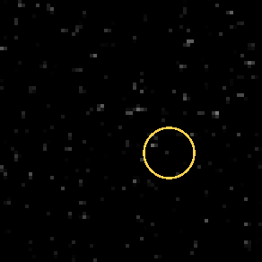
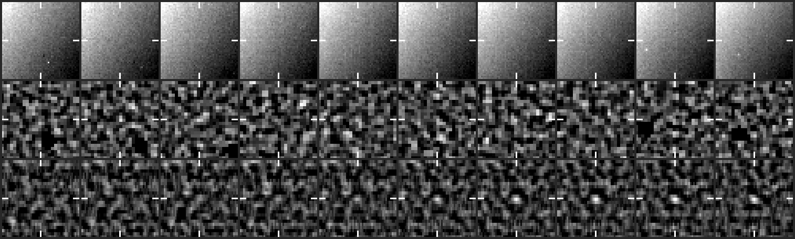
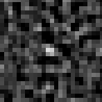

# CCOR-1 candidate 20261028T1400_1568_1292

**3 frames, 2026-10-28 14:00 to 14:30 UTC, peak 9 sigma, steady.**

- Detected by the kreutz shift-and-stack search (8 frames stacked along the fitted motion); status candidate.
- Motion (-7.0, -4.0) px per 15-min frame, 8.1 px/frame.
- Last position 639 px from the Sun at position angle -31 deg, heading 1 deg off the Sun direction (Kreutz comets in CCOR-1 arrive from the lower right, position angle -10 to -45 deg, and head within ~20 deg of the Sun).
- No CCOR-1 report matches it on the Sungrazer site.

## Movie

A fixed patch of sky at 2x the camera's resolution: significance maps (stars and corona modelled out), the last 8 maps added along the fitted motion, black below 2.5 sigma. The ring rides the fitted path: green on frames with a measured hit, yellow before the first hit. A real object crosses the patch inside the ring; noise does not travel.



## Contact sheet

Top: raw frame. Middle: significance map of that frame. Bottom: the detector's view, the last 8 maps stacked along the motion. Ticks mark the predicted position; a comet is a steady dot on the ticks.





## Positions

2048x1920 full-resolution frame, origin upper left, x right, y down, 0-based (the Sungrazer 'Upper Left' convention). They are the centre of the stacked detection predicted from the fitted motion, good to about a pixel, not per-frame centroids; hunters' measurements tend to fall ~1 px right and up of these.

| date | HHMM | x | y | sigma |
|---|---|---|---|---|
| 2026-10-28 | 1400 | 1568 | 1292 | 6.6 |
| 2026-10-28 | 1415 | 1560 | 1288 | 8.9 |
| 2026-10-28 | 1430 | 1554 | 1284 | 7.5 |

Form layout (HHMM x y):

```
1400 1568 1292
1415 1560 1288
1430 1554 1284
```

## Movie frames

Sigma inside the ring on the fitted position vs the brightest 0.1% of the whole patch. A real object sits clearly above the tail.

| frame | ring | tail | |
|---|---|---|---|
| 20261028T130025 | 3.8 | 5.2 |  |
| 20261028T131525 | 4.8 | 4.9 |  |
| 20261028T133025 | 6.8 | 5.0 |  |
| 20261028T134525 | 6.6 | 5.1 |  |
| 20261028T140025 | 9.6 | 5.2 | hit |
| 20261028T141525 | 7.4 | 5.0 | hit |
| 20261028T143025 | 8.9 | 5.0 | hit |

*Written 2026-10-28 18:14 UTC by kreutz live.*
