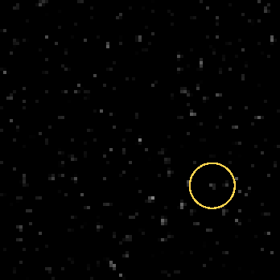
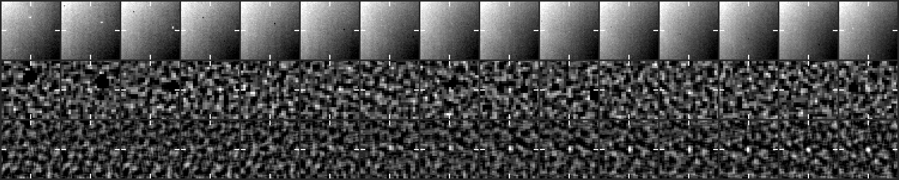
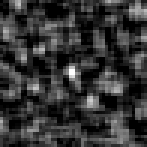

# CCOR-1 candidate 20261028T1515_1444_1456

**8 frames, 2026-10-28 15:15 to 17:00 UTC, peak 11 sigma, steady.**

- Detected by the kreutz shift-and-stack search (8 frames stacked along the fitted motion); status candidate, watch tier since 16:30 UTC.
- Motion (-8.1, -5.1) px per 15-min frame, 9.6 px/frame.
- Last position 601 px from the Sun at position angle -50 deg, heading 18 deg off the Sun direction (Kreutz comets in CCOR-1 arrive from the lower right, position angle -10 to -45 deg, and head within ~20 deg of the Sun).
- No CCOR-1 report matches it on the Sungrazer site.

## Movie

A fixed patch of sky at 2x the camera's resolution: significance maps (stars and corona modelled out), the last 8 maps added along the fitted motion, black below 2.5 sigma. The ring rides the fitted path: green on frames with a measured hit, yellow before the first hit. A real object crosses the patch inside the ring; noise does not travel.



## Contact sheet

Top: raw frame. Middle: significance map of that frame. Bottom: the detector's view, the last 8 maps stacked along the motion. Ticks mark the predicted position; a comet is a steady dot on the ticks.





## Positions

2048x1920 full-resolution frame, origin upper left, x right, y down, 0-based (the Sungrazer 'Upper Left' convention). They are the centre of the stacked detection predicted from the fitted motion, good to about a pixel, not per-frame centroids; hunters' measurements tend to fall ~1 px right and up of these.

| date | HHMM | x | y | sigma |
|---|---|---|---|---|
| 2026-10-28 | 1515 | 1444 | 1456 | 7.9 |
| 2026-10-28 | 1530 | 1436 | 1450 | 7.5 |
| 2026-10-28 | 1545 | 1428 | 1444 | 7.8 |
| 2026-10-28 | 1600 | 1420 | 1440 | 7.9 |
| 2026-10-28 | 1615 | 1412 | 1434 | 8.5 |
| 2026-10-28 | 1630 | 1404 | 1430 | 11.2 |
| 2026-10-28 | 1645 | 1394 | 1424 | 6.9 |
| 2026-10-28 | 1700 | 1388 | 1420 | 8.1 |

Form layout (HHMM x y):

```
1515 1444 1456
1530 1436 1450
1545 1428 1444
1600 1420 1440
1615 1412 1434
1630 1404 1430
1645 1394 1424
1700 1388 1420
```

## Movie frames

Sigma inside the ring on the fitted position vs the brightest 0.1% of the whole patch. A real object sits clearly above the tail.

| frame | ring | tail | |
|---|---|---|---|
| 20261028T141525 | 4.5 | 5.2 |  |
| 20261028T143025 | 5.4 | 5.4 |  |
| 20261028T144525 | 5.3 | 5.2 |  |
| 20261028T150025 | 6.9 | 5.1 |  |
| 20261028T151525 | 5.2 | 5.1 | hit |
| 20261028T153025 | 8.5 | 5.2 | hit |
| 20261028T154525 | 7.3 | 5.3 | hit |
| 20261028T160025 | 9.6 | 5.4 | hit |
| 20261028T161525 | 8.9 | 5.3 | hit |
| 20261028T163025 | 10.9 | 5.3 | hit |
| 20261028T164525 | 7.2 | 5.5 | hit |
| 20261028T170025 | 7.9 | 5.2 | hit |

*Written 2026-10-28 18:48 UTC by kreutz live.*
