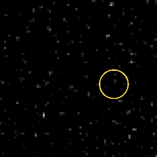
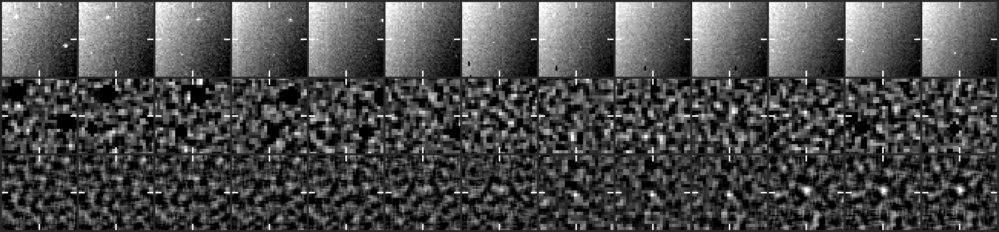
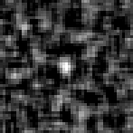

# CCOR-1 candidate 20261031T0930_1846_1134

**6 frames, 2026-10-31 09:30 to 10:45 UTC, peak 8 sigma, steady.**

- Detected by the kreutz shift-and-stack search (8 frames stacked along the fitted motion); status candidate, steady tier since 10:30 UTC.
- Motion (-7.7, -1.2) px per 15-min frame, 7.8 px/frame.
- Last position 825 px from the Sun at position angle -12 deg, heading 4 deg off the Sun direction (Kreutz comets in CCOR-1 arrive from the lower right, position angle -10 to -45 deg, and head within ~20 deg of the Sun).
- No CCOR-1 report matches it on the Sungrazer site.

## Movie

A fixed patch of sky at 2x the camera's resolution: significance maps (stars and corona modelled out), the last 8 maps added along the fitted motion, black below 2.5 sigma. The ring rides the fitted path: green on frames with a measured hit, yellow before the first hit. A real object crosses the patch inside the ring; noise does not travel.



## Contact sheet

Top: raw frame. Middle: significance map of that frame. Bottom: the detector's view, the last 8 maps stacked along the motion. Ticks mark the predicted position; a comet is a steady dot on the ticks.





## Positions

2048x1920 full-resolution frame, origin upper left, x right, y down, 0-based (the Sungrazer 'Upper Left' convention). They are the centre of the stacked detection predicted from the fitted motion, good to about a pixel, not per-frame centroids; hunters' measurements tend to fall ~1 px right and up of these.

| date | HHMM | x | y | sigma |
|---|---|---|---|---|
| 2026-10-31 | 0930 | 1846 | 1134 | 6.9 |
| 2026-10-31 | 0945 | 1838 | 1130 | 7.0 |
| 2026-10-31 | 1000 | 1830 | 1134 | 7.7 |
| 2026-10-31 | 1015 | 1824 | 1132 | 8.0 |
| 2026-10-31 | 1030 | 1814 | 1130 | 7.3 |
| 2026-10-31 | 1045 | 1808 | 1126 | 6.7 |

Form layout (HHMM x y):

```
0930 1846 1134
0945 1838 1130
1000 1830 1134
1015 1824 1132
1030 1814 1130
1045 1808 1126
```

## Movie frames

Sigma inside the ring on the fitted position vs the brightest 0.1% of the whole patch. A real object sits clearly above the tail.

| frame | ring | tail | |
|---|---|---|---|
| 20261031T083025 | 4.0 | 5.5 |  |
| 20261031T084525 | 4.1 | 5.4 |  |
| 20261031T090025 | 4.9 | 5.2 |  |
| 20261031T091525 | 4.7 | 5.4 |  |
| 20261031T093025 | 6.4 | 5.1 | hit |
| 20261031T094525 | 8.1 | 6.2 | hit |
| 20261031T100025 | 7.5 | 5.6 | hit |
| 20261031T101525 | 8.6 | 6.0 | hit |
| 20261031T103025 | 7.8 | 5.2 | hit |
| 20261031T104525 | 8.0 | 5.2 | hit |

*Written 2026-10-31 20:22 UTC.*
