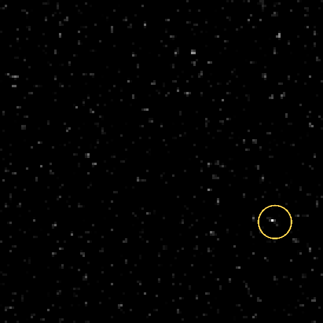
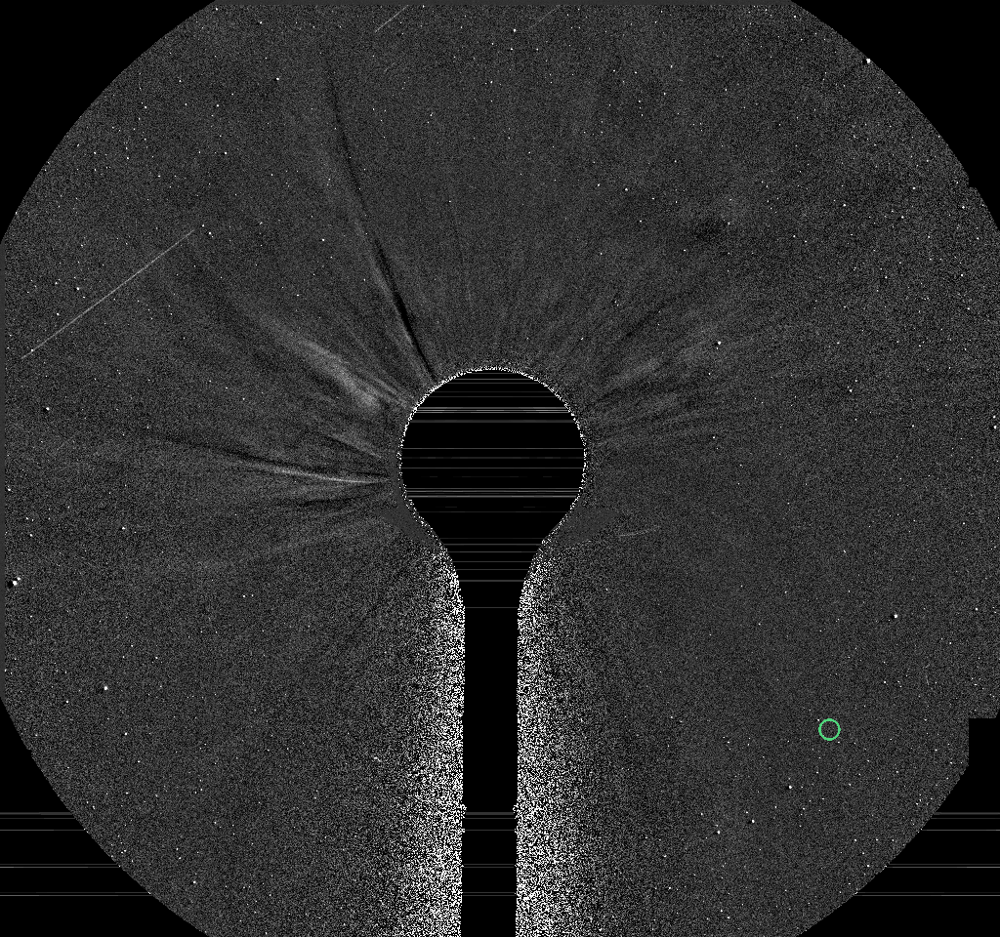
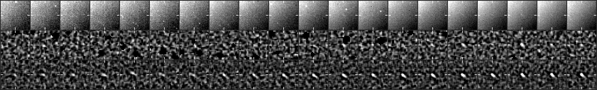
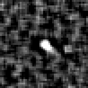

# CCOR-1 candidate 20261102T1115_1748_1520

**23 frames, 2026-11-02 11:15 to 16:45 UTC, peak 21 sigma, brightening.**

- Detected by the kreutz shift-and-stack search (8 frames stacked along the fitted motion); status candidate, alert tier since 16:00 UTC.
- Motion (-7.1, -3.8) px per 15-min frame, 8.1 px/frame.
- Last position 764 px from the Sun at position angle -40 deg, heading 12 deg off the Sun direction (Kreutz comets in CCOR-1 arrive from the lower right, position angle -10 to -45 deg, and head within ~20 deg of the Sun).
- No CCOR-1 report matches it on the Sungrazer site.

## Movie

A fixed patch of sky at 2x the camera's resolution: significance maps (stars and corona modelled out), the last 8 maps added along the fitted motion, black below 2.5 sigma. The ring rides the fitted path: green on frames with a measured hit, yellow before the first hit. A real object crosses the patch inside the ring; noise does not travel.



## Full field

The whole frame at half resolution, the last frames up to the newest hit: each frame minus the median of the five before it, no stacking, on a linear scale from -2 sigma of the frame's noise (so the noise shows as texture). For where the object sits in the corona and what else is moving; a faint object is easier to judge in the stacked patch above.



## Contact sheet

Top: raw frame. Middle: significance map of that frame. Bottom: the detector's view, the last 8 maps stacked along the motion. Ticks mark the predicted position; a comet is a steady dot on the ticks.





## Positions

2048x1920 full-resolution frame, origin upper left, x right, y down, 0-based (the Sungrazer 'Upper Left' convention). They are the centre of the stacked detection predicted from the fitted motion, good to about a pixel, not per-frame centroids; hunters' measurements tend to fall ~1 px right and up of these.

| date | HHMM | x | y | sigma |
|---|---|---|---|---|
| 2026-11-02 | 1115 | 1748 | 1520 | 8.0 |
| 2026-11-02 | 1130 | 1740 | 1516 | 8.5 |
| 2026-11-02 | 1145 | 1732 | 1512 | 9.2 |
| 2026-11-02 | 1200 | 1724 | 1508 | 8.9 |
| 2026-11-02 | 1215 | 1718 | 1504 | 8.8 |
| 2026-11-02 | 1230 | 1712 | 1500 | 9.4 |
| 2026-11-02 | 1245 | 1704 | 1498 | 8.9 |
| 2026-11-02 | 1300 | 1696 | 1494 | 9.1 |
| 2026-11-02 | 1315 | 1690 | 1490 | 10.9 |
| 2026-11-02 | 1330 | 1684 | 1486 | 11.8 |
| 2026-11-02 | 1345 | 1676 | 1482 | 10.6 |
| 2026-11-02 | 1400 | 1670 | 1480 | 11.7 |
| 2026-11-02 | 1415 | 1662 | 1474 | 14.1 |
| 2026-11-02 | 1430 | 1656 | 1470 | 12.4 |
| 2026-11-02 | 1445 | 1648 | 1468 | 11.8 |
| 2026-11-02 | 1500 | 1640 | 1464 | 11.9 |
| 2026-11-02 | 1515 | 1634 | 1460 | 12.1 |
| 2026-11-02 | 1530 | 1626 | 1456 | 13.4 |
| 2026-11-02 | 1545 | 1620 | 1452 | 13.1 |
| 2026-11-02 | 1600 | 1612 | 1448 | 17.9 |
| 2026-11-02 | 1615 | 1604 | 1444 | 18.7 |
| 2026-11-02 | 1630 | 1598 | 1440 | 16.7 |
| 2026-11-02 | 1645 | 1590 | 1436 | 20.6 |

Form layout (HHMM x y):

```
1115 1748 1520
1130 1740 1516
1145 1732 1512
1200 1724 1508
1215 1718 1504
1230 1712 1500
1245 1704 1498
1300 1696 1494
1315 1690 1490
1330 1684 1486
1345 1676 1482
1400 1670 1480
1415 1662 1474
1430 1656 1470
1445 1648 1468
1500 1640 1464
1515 1634 1460
1530 1626 1456
1545 1620 1452
1600 1612 1448
1615 1604 1444
1630 1598 1440
1645 1590 1436
```

## Movie frames

Sigma inside the ring on the fitted position vs the brightest 0.1% of the whole patch. A real object sits clearly above the tail.

| frame | ring | tail | |
|---|---|---|---|
| 20261102T101525 | 8.6 | 5.3 |  |
| 20261102T103025 | 8.9 | 5.3 |  |
| 20261102T104525 | 9.0 | 5.2 |  |
| 20261102T110025 | 8.6 | 5.1 |  |
| 20261102T111525 | 8.2 | 5.3 | hit |
| 20261102T113025 | 10.3 | 5.1 | hit |
| 20261102T114525 | 9.3 | 5.1 | hit |
| 20261102T120025 | 9.4 | 5.3 | hit |
| 20261102T121525 | 9.7 | 5.2 | hit |
| 20261102T123025 | 10.1 | 5.2 | hit |
| 20261102T124525 | 10.0 | 5.5 | hit |
| 20261102T130025 | 13.2 | 5.3 | hit |
| 20261102T131525 | 10.7 | 5.4 | hit |
| 20261102T133025 | 13.6 | 5.3 | hit |
| 20261102T134525 | 12.5 | 5.4 | hit |
| 20261102T140025 | 14.9 | 5.3 | hit |
| 20261102T141525 | 14.7 | 5.4 | hit |
| 20261102T143025 | 12.2 | 5.3 | hit |
| 20261102T144525 | 14.5 | 5.2 | hit |
| 20261102T150025 | 13.9 | 5.4 | hit |
| 20261102T151525 | 14.6 | 5.5 | hit |
| 20261102T153025 | 15.5 | 5.5 | hit |
| 20261102T154525 | 18.2 | 5.2 | hit |
| 20261102T160025 | 17.7 | 5.4 | hit |
| 20261102T161525 | 21.7 | 5.3 | hit |
| 20261102T163025 | 19.5 | 5.3 | hit |
| 20261102T164525 | 20.3 | 5.2 | hit |

*Written 2026-11-02 17:20 UTC.*
