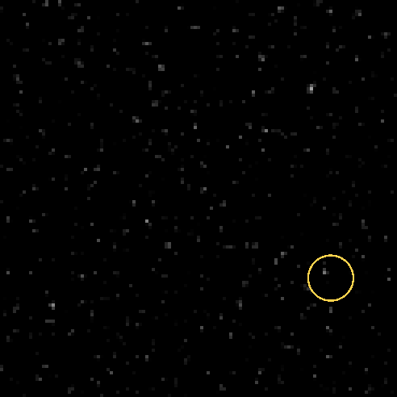
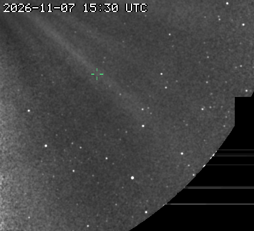
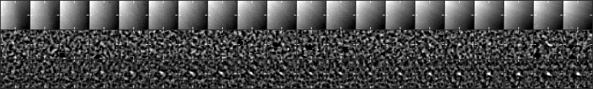
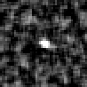

# CCOR-1 candidate 20261107T1630_1494_1376

**18 frames, 2026-11-07 16:30 to 21:00 UTC, peak 16 sigma, brightening.**

- Detected by the kreutz shift-and-stack search (8 frames stacked along the fitted motion); status candidate, alert tier since 21:00 UTC.
- Motion (-7.4, -4.5) px per 15-min frame, 8.7 px/frame.
- Last position 499 px from the Sun at position angle -44 deg, heading 13 deg off the Sun direction (Kreutz comets in CCOR-1 arrive from the lower right, position angle -10 to -45 deg, and head within ~20 deg of the Sun).
- Matches Zesheng Yang's CCOR-1 report `report_zy_20261107114905` (posted 2026-11-07T16:49+00:00; it came 4.6 h before our alert; posted 0.6 h before our third hit).

## Movie

A fixed patch of sky at 2x the camera's resolution: significance maps (stars and corona modelled out), the last 8 maps added along the fitted motion, black below 2.5 sigma. The ring rides the fitted path: green on frames with a measured hit, yellow before the first hit. A real object crosses the patch inside the ring; noise does not travel.



## Full field

The object's quadrant at half resolution, from just outside the occulter out to the field edge, the last frames up to the newest hit: each frame minus the minimum of the previous 24 hours (streamers and stars stay, the static corona and glare cancel), lightly smoothed, no stacking, on a linear scale from -2 sigma of the frame's noise (so the noise shows as grain). The crosshair follows the fitted path, yellow on a measured hit. For where the object sits in the corona and what else is moving; a faint object is easier to judge in the stacked patch above.



## Contact sheet

Top: raw frame. Middle: significance map of that frame. Bottom: the detector's view, the last 8 maps stacked along the motion. Ticks mark the predicted position; a comet is a steady dot on the ticks.





## Positions

2048x1920 full-resolution frame, origin upper left, x right, y down, 0-based (the Sungrazer 'Upper Left' convention). They are the centre of the stacked detection predicted from the fitted motion, good to about a pixel, not per-frame centroids; hunters' measurements tend to fall ~1 px right and up of these.

| date | HHMM | x | y | sigma |
|---|---|---|---|---|
| 2026-11-07 | 1630 | 1494 | 1376 | 8.3 |
| 2026-11-07 | 1645 | 1486 | 1372 | 7.8 |
| 2026-11-07 | 1700 | 1478 | 1368 | 7.7 |
| 2026-11-07 | 1715 | 1470 | 1362 | 8.0 |
| 2026-11-07 | 1730 | 1464 | 1358 | 8.0 |
| 2026-11-07 | 1745 | 1458 | 1354 | 8.5 |
| 2026-11-07 | 1800 | 1450 | 1350 | 9.2 |
| 2026-11-07 | 1815 | 1444 | 1346 | 8.4 |
| 2026-11-07 | 1830 | 1436 | 1342 | 8.1 |
| 2026-11-07 | 1900 | 1420 | 1332 | 7.5 |
| 2026-11-07 | 1915 | 1412 | 1328 | 8.7 |
| 2026-11-07 | 1930 | 1404 | 1322 | 9.5 |
| 2026-11-07 | 1945 | 1398 | 1320 | 9.2 |
| 2026-11-07 | 2000 | 1390 | 1314 | 10.6 |
| 2026-11-07 | 2015 | 1382 | 1310 | 10.3 |
| 2026-11-07 | 2030 | 1374 | 1304 | 10.8 |
| 2026-11-07 | 2045 | 1368 | 1300 | 13.5 |
| 2026-11-07 | 2100 | 1360 | 1296 | 15.6 |

Form layout (HHMM x y):

```
1630 1494 1376
1645 1486 1372
1700 1478 1368
1715 1470 1362
1730 1464 1358
1745 1458 1354
1800 1450 1350
1815 1444 1346
1830 1436 1342
1900 1420 1332
1915 1412 1328
1930 1404 1322
1945 1398 1320
2000 1390 1314
2015 1382 1310
2030 1374 1304
2045 1368 1300
2100 1360 1296
```

## Movie frames

Sigma inside the ring on the fitted position vs the brightest 0.1% of the whole patch. A real object sits clearly above the tail.

| frame | ring | tail | |
|---|---|---|---|
| 20261107T153025 | 6.0 | 4.9 |  |
| 20261107T154525 | 7.0 | 5.2 |  |
| 20261107T160025 | 7.6 | 5.5 |  |
| 20261107T161525 | 6.4 | 5.1 |  |
| 20261107T163025 | 9.2 | 5.2 | hit |
| 20261107T164525 | 9.7 | 5.2 | hit |
| 20261107T170025 | 8.7 | 5.2 | hit |
| 20261107T171525 | 9.1 | 5.2 | hit |
| 20261107T173025 | 8.9 | 5.0 | hit |
| 20261107T174525 | 7.5 | 5.1 | hit |
| 20261107T180025 | 7.8 | 5.0 | hit |
| 20261107T181525 | 9.8 | 5.0 | hit |
| 20261107T183025 | 7.9 | 5.1 | hit |
| 20261107T184525 | 8.9 | 5.0 |  |
| 20261107T190025 | 7.4 | 5.0 | hit |
| 20261107T191525 | 10.3 | 4.9 | hit |
| 20261107T193025 | 9.4 | 5.1 | hit |
| 20261107T194525 | 9.8 | 5.4 | hit |
| 20261107T200025 | 12.9 | 5.4 | hit |
| 20261107T201525 | 14.6 | 5.4 | hit |
| 20261107T203025 | 12.8 | 5.3 | hit |
| 20261107T204525 | 12.8 | 5.1 | hit |
| 20261107T210025 | 15.2 | 5.1 | hit |

*Written 2026-11-07 21:37 UTC.*
