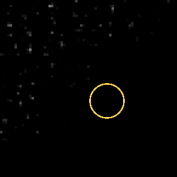
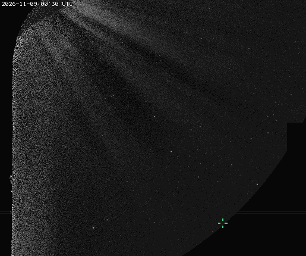
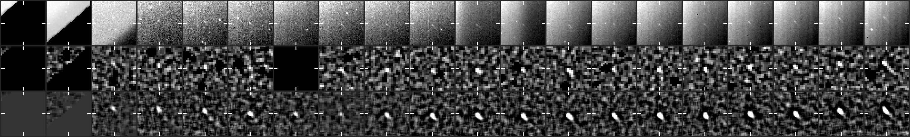
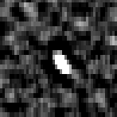

# CCOR-1 candidate 20261109T0130_1740_1790

**51 frames, 2026-11-09 01:30 to 15:30 UTC, peak 44 sigma, brightening.**

- Detected by the kreutz shift-and-stack search (8 frames stacked along the fitted motion); status candidate, alert tier since 02:30 UTC.
- Motion (-6.6, -5.0) px per 15-min frame, 8.3 px/frame.
- Last position 669 px from the Sun at position angle -57 deg, heading 20 deg off the Sun direction (Kreutz comets in CCOR-1 arrive from the lower right, position angle -10 to -45 deg, and head within ~20 deg of the Sun).
- Matches NEW USER's CCOR-1 report `report_nu_20261109090058` (posted 2026-11-09T14:00+00:00; our alert came 11.1 h before it; we were following it 11.6 h before the post).
- Owner's label: comet.

## Movie

A fixed patch of sky at 2x the camera's resolution: significance maps (stars and corona modelled out), the last 8 maps added along the fitted motion, black below 2.5 sigma. The ring rides the fitted path: green on frames with a measured hit, yellow before the first hit. A real object crosses the patch inside the ring; noise does not travel.



## Full field

The object's quadrant from just outside the occulter out to the field edge, up to the newest hit: each frame minus the median of the previous 24 hours (the static corona and glare cancel; streamers show bright where they have moved to and dark where they were; stars stay), no stacking, no smoothing, on one linear scale with zero near black, so the noise shows as grain that thickens toward the Sun. The crosshair follows the object's measured positions, yellow on a frame with a hit. This GIF is every n-th frame at half resolution; the dashboard plays every frame at the camera's resolution. A faint object is easier to judge in the stacked patch above.



## Contact sheet

Top: raw frame. Middle: significance map of that frame. Bottom: the detector's view, the last 8 maps stacked along the motion. Ticks mark the predicted position; a comet is a steady dot on the ticks.





## Positions

2048x1920 full-resolution frame, origin upper left, x right, y down, 0-based (the Sungrazer 'Upper Left' convention). They are the centre of the stacked detection predicted from the fitted motion, good to about a pixel, not per-frame centroids; hunters' measurements tend to fall ~1 px right and up of these.

| date | HHMM | x | y | sigma |
|---|---|---|---|---|
| 2026-11-09 | 0130 | 1740 | 1790 | 8.0 |
| 2026-11-09 | 0145 | 1734 | 1786 | 9.9 |
| 2026-11-09 | 0200 | 1726 | 1782 | 10.5 |
| 2026-11-09 | 0215 | 1720 | 1776 | 14.1 |
| 2026-11-09 | 0230 | 1714 | 1772 | 16.7 |
| 2026-11-09 | 0245 | 1708 | 1768 | 14.3 |
| 2026-11-09 | 0300 | 1700 | 1762 | 16.6 |
| 2026-11-09 | 0315 | 1694 | 1758 | 17.1 |
| 2026-11-09 | 0330 | 1688 | 1754 | 17.9 |
| 2026-11-09 | 0345 | 1680 | 1750 | 11.5 |
| 2026-11-09 | 0400 | 1674 | 1744 | 16.9 |
| 2026-11-09 | 0545 | 1628 | 1712 | 6.7 |
| 2026-11-09 | 0600 | 1622 | 1706 | 5.5 |
| 2026-11-09 | 0615 | 1616 | 1702 | 10.1 |
| 2026-11-09 | 0630 | 1610 | 1698 | 13.4 |
| 2026-11-09 | 0645 | 1602 | 1692 | 14.2 |
| 2026-11-09 | 0700 | 1598 | 1690 | 12.0 |
| 2026-11-09 | 0715 | 1590 | 1682 | 18.6 |
| 2026-11-09 | 0730 | 1582 | 1676 | 20.6 |
| 2026-11-09 | 0745 | 1576 | 1674 | 20.9 |
| 2026-11-09 | 0800 | 1570 | 1666 | 20.1 |
| 2026-11-09 | 0815 | 1562 | 1662 | 21.6 |
| 2026-11-09 | 0830 | 1556 | 1658 | 23.7 |
| 2026-11-09 | 0845 | 1550 | 1652 | 25.3 |
| 2026-11-09 | 0900 | 1540 | 1644 | 15.2 |
| 2026-11-09 | 0915 | 1536 | 1642 | 21.6 |
| 2026-11-09 | 0930 | 1530 | 1636 | 20.4 |
| 2026-11-09 | 0945 | 1524 | 1632 | 27.2 |
| 2026-11-09 | 1000 | 1516 | 1626 | 21.7 |
| 2026-11-09 | 1015 | 1510 | 1622 | 28.2 |
| 2026-11-09 | 1030 | 1504 | 1616 | 30.1 |
| 2026-11-09 | 1045 | 1494 | 1610 | 18.1 |
| 2026-11-09 | 1100 | 1490 | 1606 | 31.0 |
| 2026-11-09 | 1115 | 1484 | 1602 | 32.7 |
| 2026-11-09 | 1130 | 1478 | 1596 | 29.1 |
| 2026-11-09 | 1145 | 1470 | 1590 | 26.1 |
| 2026-11-09 | 1200 | 1464 | 1586 | 35.2 |
| 2026-11-09 | 1215 | 1458 | 1580 | 26.8 |
| 2026-11-09 | 1230 | 1450 | 1574 | 30.1 |
| 2026-11-09 | 1245 | 1444 | 1568 | 37.5 |
| 2026-11-09 | 1300 | 1436 | 1562 | 33.3 |
| 2026-11-09 | 1315 | 1430 | 1558 | 36.6 |
| 2026-11-09 | 1330 | 1424 | 1552 | 41.8 |
| 2026-11-09 | 1345 | 1416 | 1546 | 33.8 |
| 2026-11-09 | 1400 | 1410 | 1542 | 37.4 |
| 2026-11-09 | 1415 | 1404 | 1536 | 41.0 |
| 2026-11-09 | 1430 | 1396 | 1530 | 42.3 |
| 2026-11-09 | 1445 | 1390 | 1524 | 41.8 |
| 2026-11-09 | 1500 | 1382 | 1518 | 42.3 |
| 2026-11-09 | 1515 | 1376 | 1514 | 42.3 |
| 2026-11-09 | 1530 | 1368 | 1508 | 43.8 |

Form layout (HHMM x y):

```
0130 1740 1790
0145 1734 1786
0200 1726 1782
0215 1720 1776
0230 1714 1772
0245 1708 1768
0300 1700 1762
0315 1694 1758
0330 1688 1754
0345 1680 1750
0400 1674 1744
0545 1628 1712
0600 1622 1706
0615 1616 1702
0630 1610 1698
0645 1602 1692
0700 1598 1690
0715 1590 1682
0730 1582 1676
0745 1576 1674
0800 1570 1666
0815 1562 1662
0830 1556 1658
0845 1550 1652
0900 1540 1644
0915 1536 1642
0930 1530 1636
0945 1524 1632
1000 1516 1626
1015 1510 1622
1030 1504 1616
1045 1494 1610
1100 1490 1606
1115 1484 1602
1130 1478 1596
1145 1470 1590
1200 1464 1586
1215 1458 1580
1230 1450 1574
1245 1444 1568
1300 1436 1562
1315 1430 1558
1330 1424 1552
1345 1416 1546
1400 1410 1542
1415 1404 1536
1430 1396 1530
1445 1390 1524
1500 1382 1518
1515 1376 1514
1530 1368 1508
```

## Movie frames

Sigma inside the ring on the fitted position vs the brightest 0.1% of the whole patch. A real object sits clearly above the tail.

| frame | ring | tail | |
|---|---|---|---|
| 20261109T074525 | 16.8 | 5.3 | hit |
| 20261109T080025 | 21.1 | 5.4 | hit |
| 20261109T081525 | 23.6 | 5.3 | hit |
| 20261109T083025 | 21.1 | 5.4 | hit |
| 20261109T084525 | 24.3 | 5.2 | hit |
| 20261109T090025 | 25.9 | 5.4 | hit |
| 20261109T091525 | 27.5 | 5.4 | hit |
| 20261109T093025 | 24.2 | 5.4 | hit |
| 20261109T094525 | 26.7 | 5.4 | hit |
| 20261109T100025 | 27.7 | 5.2 | hit |
| 20261109T101525 | 26.5 | 5.0 | hit |
| 20261109T103025 | 30.4 | 5.2 | hit |
| 20261109T104525 | 23.9 | 5.2 | hit |
| 20261109T110025 | 33.4 | 5.1 | hit |
| 20261109T111525 | 26.0 | 5.6 | hit |
| 20261109T113025 | 36.4 | 5.1 | hit |
| 20261109T114525 | 35.0 | 5.1 | hit |
| 20261109T120025 | 30.1 | 5.5 | hit |
| 20261109T121525 | 40.4 | 5.3 | hit |
| 20261109T123025 | 35.8 | 5.4 | hit |
| 20261109T124525 | 38.4 | 5.6 | hit |
| 20261109T130025 | 46.2 | 5.5 | hit |
| 20261109T131525 | 40.6 | 5.6 | hit |
| 20261109T133025 | 40.9 | 5.5 | hit |
| 20261109T134525 | 46.4 | 5.5 | hit |
| 20261109T140025 | 39.5 | 5.3 | hit |
| 20261109T141525 | 39.4 | 5.3 | hit |
| 20261109T143025 | 44.6 | 5.2 | hit |
| 20261109T144525 | 44.9 | 5.5 | hit |
| 20261109T150025 | 46.9 | 5.1 | hit |
| 20261109T151525 | 36.9 | 5.2 | hit |
| 20261109T153025 | 43.5 | 5.5 | hit |

*Written 2026-11-09 16:06 UTC.*
