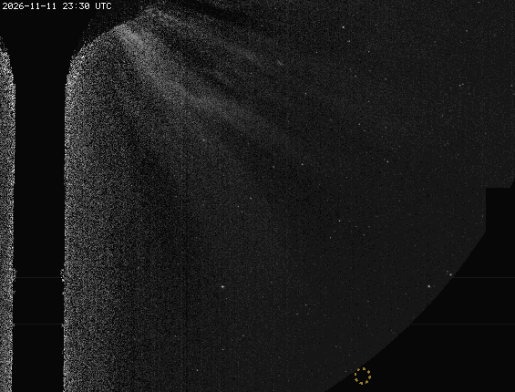
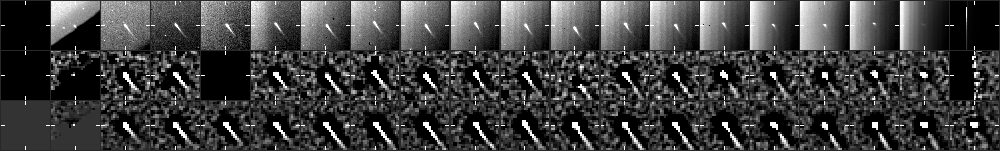
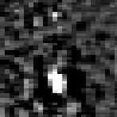

# CCOR-1 candidate 20261112T0030_1688_1866

**103 frames, 2026-11-12 00:30 to 2026-11-13 02:45 UTC, peak 265 sigma, brightening.**

- Detected by the kreutz shift-and-stack search (8 frames stacked along the fitted motion); status candidate, alert tier since 01:15 UTC.
- Motion (-5.9, -5.2) px per 15-min frame, 7.9 px/frame.
- Last position 366 px from the Sun at position angle -80 deg, heading 38 deg off the Sun direction (Kreutz comets in CCOR-1 arrive from the lower right, position angle -10 to -45 deg, and head within ~20 deg of the Sun).
- Matches NEW USER's CCOR-1 report `report_nu_20261111234439` (posted 2026-11-12T04:44+00:00; our alert came 3.1 h before it; we were following it 3.4 h before the post).

## Movie

A fixed patch of sky at 2x the camera's resolution: significance maps (stars and corona modelled out), the last 8 maps added along the fitted motion, black below 2.5 sigma. The circle sits on the object's measured positions: yellow on a frame with a measured hit, dim and dashed where it is only carried along the path (before the first hit, across a gap, after the last). A real object crosses the patch inside the circle; noise does not travel.


## Full field

The object's quadrant from just outside the occulter out to the field edge, up to the newest hit: each frame minus the median of the previous 24 hours (the static corona and glare cancel; streamers show bright where they have moved to and dark where they were; stars stay), no stacking, no smoothing, on one linear scale with zero near black, so the noise shows as grain that thickens toward the Sun. The circle is the same marker as above (yellow on a frame with a measured hit, dim and dashed otherwise), and the movie runs two hours past the last one. This GIF is every frame at half resolution; the dashboard plays them at the camera's resolution. A faint object is easier to judge in the stacked patch above.



## Contact sheet

Top: raw frame. Middle: significance map of that frame. Bottom: the detector's view, the last 8 maps stacked along the motion. Ticks mark the predicted position; a comet is a steady dot on the ticks.





## Positions

2048x1920 full-resolution frame, origin upper left, x right, y down, 0-based (the Sungrazer 'Upper Left' convention). They are the centre of the stacked detection predicted from the fitted motion, good to about a pixel, not per-frame centroids; hunters' measurements tend to fall ~1 px right and up of these.

The last column is what the track became here on that frame: spark (two bright hits, before it is a track), following (third hit), then each of the dashboard's tiers the first time it stood higher than before (steady, watch, ALERT). The owner's tags carry their clock time and sit on the newest frame that had reached us when they were given; the rest are frame times, and a frame reaches us 15 to 25 minutes after it is taken.

| date | HHMM | x | y | sigma | our status |
|---|---|---|---|---|---|
| 2026-11-12 | 0030 | 1688 | 1866 | 10.6 |  |
| 2026-11-12 | 0045 | 1682 | 1862 | 38.8 | spark |
| 2026-11-12 | 0100 | 1676 | 1858 | 68.8 | following |
| 2026-11-12 | 0115 | 1670 | 1854 | 103.2 | ALERT |
| 2026-11-12 | 0130 | 1664 | 1850 | 127.9 |  |
| 2026-11-12 | 0145 | 1658 | 1844 | 163.1 |  |
| 2026-11-12 | 0200 | 1652 | 1840 | 194.8 |  |
| 2026-11-12 | 0215 | 1646 | 1836 | 237.6 |  |
| 2026-11-12 | 0230 | 1640 | 1832 | 231.5 |  |
| 2026-11-12 | 0245 | 1634 | 1828 | 221.2 |  |
| 2026-11-12 | 0300 | 1628 | 1822 | 237.6 |  |
| 2026-11-12 | 0315 | 1622 | 1818 | 259.1 |  |
| 2026-11-12 | 0330 | 1616 | 1814 | 246.5 |  |
| 2026-11-12 | 0345 | 1610 | 1808 | 243.9 |  |
| 2026-11-12 | 0400 | 1604 | 1804 | 253.8 |  |
| 2026-11-12 | 0415 | 1598 | 1800 | 258.9 |  |
| 2026-11-12 | 0515 | 1574 | 1782 | 138.6 |  |
| 2026-11-12 | 0530 | 1570 | 1776 | 144.6 |  |
| 2026-11-12 | 0545 | 1564 | 1772 | 145.5 |  |
| 2026-11-12 | 0600 | 1558 | 1768 | 150.5 |  |
| 2026-11-12 | 0615 | 1552 | 1762 | 151.2 |  |
| 2026-11-12 | 0630 | 1546 | 1758 | 189.0 |  |
| 2026-11-12 | 0645 | 1540 | 1754 | 225.0 |  |
| 2026-11-12 | 0700 | 1534 | 1748 | 246.6 |  |
| 2026-11-12 | 0715 | 1528 | 1744 | 242.0 |  |
| 2026-11-12 | 0730 | 1522 | 1738 | 254.2 |  |
| 2026-11-12 | 0745 | 1518 | 1734 | 244.9 |  |
| 2026-11-12 | 0800 | 1512 | 1730 | 246.5 |  |
| 2026-11-12 | 0815 | 1506 | 1726 | 258.8 |  |
| 2026-11-12 | 0830 | 1500 | 1720 | 252.1 |  |
| 2026-11-12 | 0845 | 1494 | 1716 | 257.8 |  |
| 2026-11-12 | 0900 | 1490 | 1712 | 263.1 |  |
| 2026-11-12 | 0915 | 1482 | 1706 | 260.7 |  |
| 2026-11-12 | 0930 | 1476 | 1700 | 257.3 |  |
| 2026-11-12 | 0945 | 1472 | 1696 | 242.6 |  |
| 2026-11-12 | 1000 | 1466 | 1692 | 249.4 |  |
| 2026-11-12 | 1015 | 1460 | 1686 | 259.5 |  |
| 2026-11-12 | 1030 | 1454 | 1680 | 264.2 |  |
| 2026-11-12 | 1045 | 1448 | 1676 | 264.2 |  |
| 2026-11-12 | 1100 | 1442 | 1670 | 264.6 |  |
| 2026-11-12 | 1115 | 1436 | 1666 | 264.6 |  |
| 2026-11-12 | 1130 | 1430 | 1660 | 263.2 |  |
| 2026-11-12 | 1145 | 1426 | 1658 | 235.0 |  |
| 2026-11-12 | 1200 | 1420 | 1652 | 238.2 |  |
| 2026-11-12 | 1215 | 1414 | 1648 | 220.4 |  |
| 2026-11-12 | 1230 | 1408 | 1642 | 241.6 |  |
| 2026-11-12 | 1245 | 1404 | 1638 | 235.8 |  |
| 2026-11-12 | 1300 | 1396 | 1630 | 245.7 |  |
| 2026-11-12 | 1315 | 1392 | 1626 | 226.8 |  |
| 2026-11-12 | 1330 | 1384 | 1620 | 225.3 |  |
| 2026-11-12 | 1345 | 1378 | 1616 | 262.5 |  |
| 2026-11-12 | 1400 | 1374 | 1610 | 252.1 |  |
| 2026-11-12 | 1415 | 1366 | 1604 | 257.5 |  |
| 2026-11-12 | 1430 | 1362 | 1600 | 264.0 |  |
| 2026-11-12 | 1445 | 1356 | 1594 | 264.6 |  |
| 2026-11-12 | 1500 | 1350 | 1586 | 194.5 |  |
| 2026-11-12 | 1515 | 1344 | 1584 | 222.0 |  |
| 2026-11-12 | 1530 | 1338 | 1578 | 226.8 |  |
| 2026-11-12 | 1545 | 1332 | 1574 | 226.8 |  |
| 2026-11-12 | 1600 | 1326 | 1568 | 223.2 |  |
| 2026-11-12 | 1615 | 1320 | 1562 | 226.8 |  |
| 2026-11-12 | 1630 | 1314 | 1558 | 226.8 |  |
| 2026-11-12 | 1645 | 1308 | 1552 | 226.8 |  |
| 2026-11-12 | 1700 | 1302 | 1546 | 264.6 |  |
| 2026-11-12 | 1715 | 1296 | 1540 | 264.6 |  |
| 2026-11-12 | 1730 | 1292 | 1536 | 263.3 |  |
| 2026-11-12 | 1745 | 1284 | 1530 | 264.6 |  |
| 2026-11-12 | 1800 | 1278 | 1524 | 264.6 |  |
| 2026-11-12 | 1815 | 1274 | 1520 | 264.6 |  |
| 2026-11-12 | 1830 | 1268 | 1514 | 264.6 |  |
| 2026-11-12 | 1845 | 1260 | 1508 | 264.6 |  |
| 2026-11-12 | 1900 | 1254 | 1502 | 264.6 |  |
| 2026-11-12 | 1915 | 1250 | 1498 | 264.6 |  |
| 2026-11-12 | 1930 | 1244 | 1492 | 264.6 |  |
| 2026-11-12 | 1945 | 1238 | 1486 | 264.6 |  |
| 2026-11-12 | 2000 | 1230 | 1480 | 263.2 |  |
| 2026-11-12 | 2015 | 1226 | 1474 | 261.1 |  |
| 2026-11-12 | 2030 | 1220 | 1468 | 264.6 |  |
| 2026-11-12 | 2045 | 1214 | 1462 | 263.9 |  |
| 2026-11-12 | 2100 | 1206 | 1456 | 261.6 |  |
| 2026-11-12 | 2115 | 1200 | 1450 | 264.6 |  |
| 2026-11-12 | 2130 | 1194 | 1444 | 264.6 |  |
| 2026-11-12 | 2145 | 1188 | 1438 | 264.6 |  |
| 2026-11-12 | 2200 | 1182 | 1432 | 264.6 |  |
| 2026-11-12 | 2215 | 1176 | 1426 | 264.6 |  |
| 2026-11-12 | 2230 | 1170 | 1420 | 264.6 |  |
| 2026-11-12 | 2245 | 1164 | 1414 | 264.6 |  |
| 2026-11-12 | 2300 | 1158 | 1408 | 264.6 |  |
| 2026-11-12 | 2315 | 1152 | 1402 | 264.6 |  |
| 2026-11-12 | 2330 | 1146 | 1396 | 264.1 |  |
| 2026-11-12 | 2345 | 1140 | 1390 | 258.1 |  |
| 2026-11-13 | 0000 | 1134 | 1384 | 246.6 |  |
| 2026-11-13 | 0015 | 1128 | 1376 | 245.6 |  |
| 2026-11-13 | 0030 | 1122 | 1370 | 213.7 |  |
| 2026-11-13 | 0045 | 1116 | 1362 | 209.7 |  |
| 2026-11-13 | 0100 | 1110 | 1356 | 192.7 |  |
| 2026-11-13 | 0115 | 1104 | 1350 | 184.2 |  |
| 2026-11-13 | 0130 | 1098 | 1344 | 142.2 |  |
| 2026-11-13 | 0145 | 1090 | 1336 | 120.9 |  |
| 2026-11-13 | 0200 | 1084 | 1330 | 94.8 |  |
| 2026-11-13 | 0215 | 1078 | 1324 | 77.3 |  |
| 2026-11-13 | 0230 | 1072 | 1318 | 53.3 |  |
| 2026-11-13 | 0245 | 1068 | 1308 | 37.7 |  |

Form layout (HHMM x y):

```
0030 1688 1866
0045 1682 1862
0100 1676 1858
0115 1670 1854
0130 1664 1850
0145 1658 1844
0200 1652 1840
0215 1646 1836
0230 1640 1832
0245 1634 1828
0300 1628 1822
0315 1622 1818
0330 1616 1814
0345 1610 1808
0400 1604 1804
0415 1598 1800
0515 1574 1782
0530 1570 1776
0545 1564 1772
0600 1558 1768
0615 1552 1762
0630 1546 1758
0645 1540 1754
0700 1534 1748
0715 1528 1744
0730 1522 1738
0745 1518 1734
0800 1512 1730
0815 1506 1726
0830 1500 1720
0845 1494 1716
0900 1490 1712
0915 1482 1706
0930 1476 1700
0945 1472 1696
1000 1466 1692
1015 1460 1686
1030 1454 1680
1045 1448 1676
1100 1442 1670
1115 1436 1666
1130 1430 1660
1145 1426 1658
1200 1420 1652
1215 1414 1648
1230 1408 1642
1245 1404 1638
1300 1396 1630
1315 1392 1626
1330 1384 1620
1345 1378 1616
1400 1374 1610
1415 1366 1604
1430 1362 1600
1445 1356 1594
1500 1350 1586
1515 1344 1584
1530 1338 1578
1545 1332 1574
1600 1326 1568
1615 1320 1562
1630 1314 1558
1645 1308 1552
1700 1302 1546
1715 1296 1540
1730 1292 1536
1745 1284 1530
1800 1278 1524
1815 1274 1520
1830 1268 1514
1845 1260 1508
1900 1254 1502
1915 1250 1498
1930 1244 1492
1945 1238 1486
2000 1230 1480
2015 1226 1474
2030 1220 1468
2045 1214 1462
2100 1206 1456
2115 1200 1450
2130 1194 1444
2145 1188 1438
2200 1182 1432
2215 1176 1426
2230 1170 1420
2245 1164 1414
2300 1158 1408
2315 1152 1402
2330 1146 1396
2345 1140 1390
0000 1134 1384
0015 1128 1376
0030 1122 1370
0045 1116 1362
0100 1110 1356
0115 1104 1350
0130 1098 1344
0145 1090 1336
0200 1084 1330
0215 1078 1324
0230 1072 1318
0245 1068 1308
```

## Movie frames

Sigma inside the ring on the fitted position vs the brightest 0.1% of the whole patch. A real object sits clearly above the tail.

| frame | ring | tail | |
|---|---|---|---|
| 20261111T233025 | 0.0 | 5.4 |  |
| 20261111T234525 | 0.0 | 5.4 |  |
| 20261112T000025 | 0.0 | 5.4 |  |
| 20261112T001525 | 9.9 | 5.5 |  |
| 20261112T003025 | 38.0 | 5.4 | hit |
| 20261112T004525 | 60.4 | 5.5 | hit |
| 20261112T010025 | 83.8 | 5.4 | hit |
| 20261112T011525 | 114.9 | 5.6 | hit |
| 20261112T013025 | 150.1 | 5.6 | hit |
| 20261112T014525 | 183.1 | 5.6 | hit |
| 20261112T020025 | 217.6 | 5.5 | hit |
| 20261112T021525 | 252.9 | 5.5 | hit |
| 20261112T023025 | 267.3 | 5.5 | hit |
| 20261112T024525 | 274.8 | 5.5 | hit |
| 20261112T030025 | 278.0 | 5.7 | hit |
| 20261112T031525 | 278.0 | 5.9 | hit |
| 20261112T033025 | 278.1 | 6.2 | hit |
| 20261112T034525 | 280.5 | 6.2 | hit |
| 20261112T040025 | 281.4 | 6.1 | hit |
| 20261112T041525 | 281.4 | 7.6 | hit |
| 20261112T043025 | 246.0 | 7.4 |  |
| 20261112T044525 | 212.1 | 7.3 |  |
| 20261112T050025 | 176.8 | 6.8 |  |
| 20261112T051525 | 165.0 | 7.5 | hit |
| 20261112T053025 | 165.0 | 7.6 | hit |
| 20261112T054525 | 165.0 | 7.8 | hit |
| 20261112T060025 | 165.0 | 7.9 | hit |
| 20261112T061525 | 165.0 | 6.7 | hit |
| 20261112T063025 | 200.3 | 6.9 | hit |
| 20261112T064525 | 234.0 | 7.1 | hit |
| 20261112T070025 | 269.4 | 7.3 | hit |
| 20261112T071525 | 279.8 | 6.0 | hit |
| 20261112T073025 | 273.1 | 5.6 | hit |
| 20261112T074525 | 273.1 | 5.6 | hit |
| 20261112T080025 | 273.1 | 5.5 | hit |
| 20261112T081525 | 273.1 | 5.4 | hit |
| 20261112T083025 | 273.1 | 5.3 | hit |
| 20261112T084525 | 274.5 | 5.3 | hit |
| 20261112T090025 | 274.5 | 5.3 | hit |
| 20261112T091525 | 272.5 | 5.3 | hit |
| 20261112T093025 | 275.6 | 5.3 | hit |
| 20261112T094525 | 275.6 | 5.2 | hit |
| 20261112T100025 | 275.6 | 5.2 | hit |
| 20261112T101525 | 275.6 | 5.2 | hit |
| 20261112T103025 | 275.6 | 5.2 | hit |
| 20261112T104525 | 276.0 | 5.2 | hit |
| 20261112T110025 | 276.0 | 5.2 | hit |
| 20261112T111525 | 279.3 | 5.2 | hit |
| 20261112T113025 | 281.6 | 5.3 | hit |
| 20261112T114525 | 264.0 | 5.4 | hit |
| 20261112T120025 | 264.0 | 5.4 | hit |
| 20261112T121525 | 260.2 | 5.5 | hit |
| 20261112T123025 | 260.2 | 5.5 | hit |
| 20261112T124525 | 259.7 | 5.4 | hit |
| 20261112T130025 | 259.7 | 5.4 | hit |
| 20261112T131525 | 259.7 | 5.4 | hit |
| 20261112T133025 | 260.9 | 5.3 | hit |
| 20261112T134525 | 276.7 | 5.4 | hit |
| 20261112T140025 | 276.7 | 5.4 | hit |
| 20261112T141525 | 275.7 | 5.4 | hit |
| 20261112T143025 | 275.7 | 5.4 | hit |
| 20261112T144525 | 276.2 | 5.3 | hit |
| 20261112T150025 | 241.2 | 5.4 | hit |
| 20261112T151525 | 241.2 | 5.5 | hit |
| 20261112T153025 | 241.2 | 5.5 | hit |
| 20261112T154525 | 243.1 | 5.4 | hit |
| 20261112T160025 | 243.1 | 5.4 | hit |
| 20261112T161525 | 247.8 | 5.4 | hit |
| 20261112T163025 | 247.8 | 5.4 | hit |
| 20261112T164525 | 247.8 | 5.4 | hit |
| 20261112T170025 | 282.8 | 5.5 | hit |
| 20261112T171525 | 282.8 | 5.5 | hit |
| 20261112T173025 | 282.8 | 5.5 | hit |
| 20261112T174525 | 282.8 | 5.6 | hit |
| 20261112T180025 | 282.8 | 5.5 | hit |
| 20261112T181525 | 282.8 | 5.5 | hit |
| 20261112T183025 | 282.8 | 5.6 | hit |
| 20261112T184525 | 282.8 | 5.5 | hit |
| 20261112T190025 | 282.8 | 5.5 | hit |
| 20261112T191525 | 282.8 | 5.5 | hit |
| 20261112T193025 | 282.8 | 5.4 | hit |
| 20261112T194525 | 282.8 | 5.5 | hit |
| 20261112T200025 | 282.8 | 5.5 | hit |
| 20261112T201525 | 282.8 | 5.4 | hit |
| 20261112T203025 | 282.8 | 5.3 | hit |
| 20261112T204525 | 282.2 | 5.4 | hit |
| 20261112T210025 | 282.2 | 5.3 | hit |
| 20261112T211525 | 282.2 | 5.6 | hit |
| 20261112T213025 | 282.2 | 5.5 | hit |
| 20261112T214525 | 282.2 | 5.5 | hit |
| 20261112T220025 | 282.2 | 5.5 | hit |
| 20261112T221525 | 282.2 | 5.5 | hit |
| 20261112T223025 | 282.2 | 5.5 | hit |
| 20261112T224525 | 282.8 | 5.4 | hit |
| 20261112T230025 | 282.8 | 5.5 | hit |
| 20261112T231525 | 282.8 | 5.5 | hit |
| 20261112T233025 | 282.4 | 5.4 | hit |
| 20261112T234525 | 276.8 | 5.4 | hit |
| 20261113T000025 | 266.0 | 5.4 | hit |
| 20261113T001525 | 263.2 | 5.4 | hit |
| 20261113T003025 | 259.0 | 5.3 | hit |
| 20261113T004525 | 240.9 | 5.5 | hit |
| 20261113T010025 | 219.7 | 5.4 | hit |
| 20261113T011525 | 196.1 | 5.4 | hit |
| 20261113T013025 | 168.8 | 5.4 | hit |
| 20261113T014525 | 147.3 | 5.3 | hit |
| 20261113T020025 | 127.5 | 5.4 | hit |
| 20261113T021525 | 98.3 | 5.3 | hit |
| 20261113T023025 | 68.0 | 5.3 | hit |
| 20261113T024525 | 52.9 | 5.4 | hit |
| 20261113T030025 | 38.6 | 5.6 |  |
| 20261113T031525 | 27.0 | 6.0 |  |
| 20261113T033025 | 19.3 | 6.0 |  |
| 20261113T034516 | 12.5 | 6.0 |  |
| 20261113T040016 | 9.5 | 6.5 |  |
| 20261113T041516 | 5.7 | 7.4 |  |
| 20261113T043016 | 3.3 | 7.3 |  |
| 20261113T044516 | 3.3 | 6.7 |  |

*Written 2026-11-13 05:25 UTC.*
