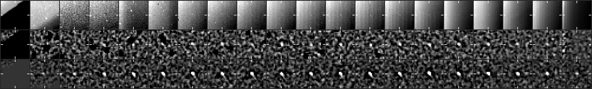

# CCOR-1 candidate 20261122T0800_1654_1858

**112 frames, 2026-11-22 08:00 to 2026-11-23 12:00 UTC, peak 37 sigma, steady.**

- Detected by the kreutz shift-and-stack search (8 frames stacked along the fitted motion); status candidate, alert tier since 09:45 UTC.
- Motion (-5.0, -5.0) px per 15-min frame, 7.1 px/frame.
- Last position 354 px from the Sun at position angle -75 deg, heading 30 deg off the Sun direction (Kreutz comets in CCOR-1 arrive from the lower right, position angle -10 to -45 deg, and head within ~20 deg of the Sun).
- Matches Kristof Ujfalussy's CCOR-1 report `report_ku_20261122170935` (posted 2026-11-22T22:09+00:00; our alert came 12.0 h before it; we were following it 13.3 h before the post).

## Movie

A fixed patch of sky at 2x the camera's resolution: significance maps (stars and corona modelled out), the last 8 maps added along the fitted motion, black below 2.5 sigma. The circle sits on the object's measured positions: yellow on a frame with a measured hit, dim and dashed where it is only carried along the path (before the first hit, across a gap, after the last). A real object crosses the patch inside the circle; noise does not travel.


## Full field

The object's quadrant from just outside the occulter out to the field edge, up to the newest hit: each frame minus the median of the previous 24 hours (the static corona and glare cancel; streamers show bright where they have moved to and dark where they were; stars stay), no stacking, no smoothing, on one linear scale with zero near black, so the noise shows as grain that thickens toward the Sun. The circle is the same marker as above (yellow on a frame with a measured hit, dim and dashed otherwise), and the movie runs two hours past the last one. This GIF is every frame at half resolution; the dashboard plays them at the camera's resolution. A faint object is easier to judge in the stacked patch above.


## Contact sheet

Top: raw frame. Middle: significance map of that frame. Bottom: the detector's view, the last 8 maps stacked along the motion. Ticks mark the predicted position; a comet is a steady dot on the ticks.




## Positions

2048x1920 full-resolution frame, origin upper left, x right, y down, 0-based (the Sungrazer 'Upper Left' convention). They are the centre of the stacked detection predicted from the fitted motion, good to about a pixel, not per-frame centroids; hunters' measurements tend to fall ~1 px right and up of these.

The last column is what the track became here on that frame: spark (two bright hits, before it is a track), following (third hit), then each of the dashboard's tiers the first time it stood higher than before (steady, watch, ALERT). The owner's tags carry their clock time and sit on the newest frame that had reached us when they were given; the rest are frame times, and a frame reaches us 15 to 25 minutes after it is taken.

| date | HHMM | x | y | sigma | our status |
|---|---|---|---|---|---|
| 2026-11-22 | 0800 | 1654 | 1858 | 7.1 |  |
| 2026-11-22 | 0815 | 1650 | 1856 | 7.1 |  |
| 2026-11-22 | 0830 | 1642 | 1850 | 9.2 | following |
| 2026-11-22 | 0845 | 1638 | 1844 | 12.1 |  |
| 2026-11-22 | 0900 | 1634 | 1840 | 12.4 | watch |
| 2026-11-22 | 0915 | 1628 | 1836 | 12.9 |  |
| 2026-11-22 | 0930 | 1624 | 1830 | 12.9 |  |
| 2026-11-22 | 0945 | 1618 | 1826 | 15.3 | ALERT |
| 2026-11-22 | 1000 | 1614 | 1822 | 14.1 |  |
| 2026-11-22 | 1015 | 1608 | 1818 | 15.8 |  |
| 2026-11-22 | 1030 | 1604 | 1814 | 16.0 |  |
| 2026-11-22 | 1045 | 1598 | 1808 | 14.9 |  |
| 2026-11-22 | 1100 | 1594 | 1804 | 16.4 |  |
| 2026-11-22 | 1115 | 1590 | 1800 | 15.9 |  |
| 2026-11-22 | 1130 | 1584 | 1794 | 18.9 |  |
| 2026-11-22 | 1145 | 1580 | 1790 | 17.8 |  |
| 2026-11-22 | 1200 | 1576 | 1786 | 20.5 |  |
| 2026-11-22 | 1215 | 1572 | 1782 | 21.0 |  |
| 2026-11-22 | 1230 | 1566 | 1776 | 19.7 |  |
| 2026-11-22 | 1245 | 1562 | 1774 | 15.0 |  |
| 2026-11-22 | 1300 | 1554 | 1768 | 17.5 |  |
| 2026-11-22 | 1315 | 1550 | 1764 | 19.3 |  |
| 2026-11-22 | 1330 | 1546 | 1758 | 19.6 |  |
| 2026-11-22 | 1345 | 1542 | 1754 | 20.3 |  |
| 2026-11-22 | 1400 | 1538 | 1750 | 18.1 |  |
| 2026-11-22 | 1415 | 1532 | 1744 | 20.8 |  |
| 2026-11-22 | 1430 | 1526 | 1738 | 20.4 |  |
| 2026-11-22 | 1445 | 1520 | 1736 | 20.6 |  |
| 2026-11-22 | 1500 | 1516 | 1730 | 20.1 |  |
| 2026-11-22 | 1515 | 1512 | 1726 | 20.7 |  |
| 2026-11-22 | 1530 | 1508 | 1722 | 19.7 |  |
| 2026-11-22 | 1545 | 1502 | 1716 | 22.8 |  |
| 2026-11-22 | 1600 | 1498 | 1712 | 20.8 |  |
| 2026-11-22 | 1615 | 1492 | 1706 | 26.0 |  |
| 2026-11-22 | 1630 | 1486 | 1700 | 19.5 |  |
| 2026-11-22 | 1645 | 1482 | 1696 | 21.5 |  |
| 2026-11-22 | 1700 | 1478 | 1694 | 21.9 |  |
| 2026-11-22 | 1715 | 1472 | 1688 | 17.9 |  |
| 2026-11-22 | 1730 | 1468 | 1684 | 23.8 |  |
| 2026-11-22 | 1745 | 1462 | 1678 | 21.9 |  |
| 2026-11-22 | 1800 | 1458 | 1674 | 21.3 |  |
| 2026-11-22 | 1815 | 1452 | 1668 | 25.4 |  |
| 2026-11-22 | 1830 | 1448 | 1664 | 28.7 |  |
| 2026-11-22 | 1845 | 1442 | 1658 | 21.2 |  |
| 2026-11-22 | 1900 | 1438 | 1654 | 25.5 |  |
| 2026-11-22 | 1915 | 1434 | 1650 | 23.2 |  |
| 2026-11-22 | 1930 | 1428 | 1646 | 25.3 |  |
| 2026-11-22 | 1945 | 1422 | 1640 | 20.7 |  |
| 2026-11-22 | 2000 | 1418 | 1636 | 23.7 |  |
| 2026-11-22 | 2030 | 1408 | 1626 | 20.8 |  |
| 2026-11-22 | 2045 | 1404 | 1622 | 22.3 |  |
| 2026-11-22 | 2100 | 1398 | 1616 | 23.4 |  |
| 2026-11-22 | 2115 | 1394 | 1614 | 20.7 |  |
| 2026-11-22 | 2130 | 1388 | 1606 | 24.5 |  |
| 2026-11-22 | 2145 | 1384 | 1602 | 21.0 |  |
| 2026-11-22 | 2200 | 1378 | 1596 | 26.6 |  |
| 2026-11-22 | 2215 | 1374 | 1592 | 23.4 |  |
| 2026-11-22 | 2230 | 1368 | 1588 | 24.0 |  |
| 2026-11-22 | 2245 | 1364 | 1582 | 23.7 |  |
| 2026-11-22 | 2300 | 1358 | 1576 | 29.1 |  |
| 2026-11-22 | 2315 | 1354 | 1572 | 31.8 |  |
| 2026-11-22 | 2330 | 1348 | 1566 | 33.4 |  |
| 2026-11-22 | 2345 | 1344 | 1562 | 33.4 |  |
| 2026-11-23 | 0000 | 1338 | 1556 | 31.2 |  |
| 2026-11-23 | 0015 | 1334 | 1552 | 31.3 |  |
| 2026-11-23 | 0030 | 1328 | 1546 | 35.2 |  |
| 2026-11-23 | 0045 | 1324 | 1542 | 31.3 |  |
| 2026-11-23 | 0100 | 1318 | 1536 | 30.3 |  |
| 2026-11-23 | 0115 | 1312 | 1530 | 32.2 |  |
| 2026-11-23 | 0130 | 1308 | 1526 | 32.6 |  |
| 2026-11-23 | 0145 | 1302 | 1520 | 34.4 |  |
| 2026-11-23 | 0200 | 1298 | 1516 | 36.0 |  |
| 2026-11-23 | 0215 | 1292 | 1510 | 28.4 |  |
| 2026-11-23 | 0230 | 1288 | 1506 | 36.3 |  |
| 2026-11-23 | 0245 | 1282 | 1500 | 34.9 |  |
| 2026-11-23 | 0300 | 1278 | 1496 | 36.6 |  |
| 2026-11-23 | 0315 | 1272 | 1490 | 35.1 |  |
| 2026-11-23 | 0330 | 1266 | 1484 | 33.2 |  |
| 2026-11-23 | 0345 | 1262 | 1480 | 33.7 |  |
| 2026-11-23 | 0400 | 1258 | 1476 | 33.9 |  |
| 2026-11-23 | 0415 | 1252 | 1468 | 37.2 |  |
| 2026-11-23 | 0430 | 1248 | 1462 | 36.1 |  |
| 2026-11-23 | 0445 | 1242 | 1458 | 32.5 |  |
| 2026-11-23 | 0500 | 1238 | 1452 | 34.0 |  |
| 2026-11-23 | 0515 | 1232 | 1446 | 28.4 |  |
| 2026-11-23 | 0530 | 1228 | 1442 | 23.5 |  |
| 2026-11-23 | 0545 | 1222 | 1436 | 29.5 |  |
| 2026-11-23 | 0600 | 1216 | 1430 | 28.8 |  |
| 2026-11-23 | 0615 | 1212 | 1424 | 27.5 |  |
| 2026-11-23 | 0630 | 1206 | 1420 | 24.1 |  |
| 2026-11-23 | 0645 | 1202 | 1414 | 29.6 |  |
| 2026-11-23 | 0700 | 1196 | 1408 | 29.9 |  |
| 2026-11-23 | 0715 | 1192 | 1402 | 27.4 |  |
| 2026-11-23 | 0730 | 1188 | 1396 | 24.0 |  |
| 2026-11-23 | 0745 | 1182 | 1390 | 26.0 |  |
| 2026-11-23 | 0800 | 1176 | 1384 | 24.3 |  |
| 2026-11-23 | 0815 | 1172 | 1380 | 26.3 |  |
| 2026-11-23 | 0830 | 1168 | 1372 | 21.9 |  |
| 2026-11-23 | 0845 | 1162 | 1368 | 22.7 |  |
| 2026-11-23 | 0900 | 1158 | 1362 | 19.9 |  |
| 2026-11-23 | 0915 | 1152 | 1356 | 20.1 |  |
| 2026-11-23 | 0930 | 1148 | 1350 | 18.1 |  |
| 2026-11-23 | 0945 | 1142 | 1344 | 19.7 |  |
| 2026-11-23 | 1000 | 1136 | 1338 | 19.0 |  |
| 2026-11-23 | 1015 | 1132 | 1332 | 16.4 |  |
| 2026-11-23 | 1030 | 1126 | 1326 | 14.9 |  |
| 2026-11-23 | 1045 | 1122 | 1320 | 17.9 |  |
| 2026-11-23 | 1100 | 1116 | 1314 | 15.1 |  |
| 2026-11-23 | 1115 | 1112 | 1308 | 11.1 |  |
| 2026-11-23 | 1130 | 1106 | 1302 | 12.4 |  |
| 2026-11-23 | 1145 | 1104 | 1296 | 8.9 |  |
| 2026-11-23 | 1200 | 1096 | 1290 | 8.4 |  |

Form layout (HHMM x y):

```
0800 1654 1858
0815 1650 1856
0830 1642 1850
0845 1638 1844
0900 1634 1840
0915 1628 1836
0930 1624 1830
0945 1618 1826
1000 1614 1822
1015 1608 1818
1030 1604 1814
1045 1598 1808
1100 1594 1804
1115 1590 1800
1130 1584 1794
1145 1580 1790
1200 1576 1786
1215 1572 1782
1230 1566 1776
1245 1562 1774
1300 1554 1768
1315 1550 1764
1330 1546 1758
1345 1542 1754
1400 1538 1750
1415 1532 1744
1430 1526 1738
1445 1520 1736
1500 1516 1730
1515 1512 1726
1530 1508 1722
1545 1502 1716
1600 1498 1712
1615 1492 1706
1630 1486 1700
1645 1482 1696
1700 1478 1694
1715 1472 1688
1730 1468 1684
1745 1462 1678
1800 1458 1674
1815 1452 1668
1830 1448 1664
1845 1442 1658
1900 1438 1654
1915 1434 1650
1930 1428 1646
1945 1422 1640
2000 1418 1636
2030 1408 1626
2045 1404 1622
2100 1398 1616
2115 1394 1614
2130 1388 1606
2145 1384 1602
2200 1378 1596
2215 1374 1592
2230 1368 1588
2245 1364 1582
2300 1358 1576
2315 1354 1572
2330 1348 1566
2345 1344 1562
0000 1338 1556
0015 1334 1552
0030 1328 1546
0045 1324 1542
0100 1318 1536
0115 1312 1530
0130 1308 1526
0145 1302 1520
0200 1298 1516
0215 1292 1510
0230 1288 1506
0245 1282 1500
0300 1278 1496
0315 1272 1490
0330 1266 1484
0345 1262 1480
0400 1258 1476
0415 1252 1468
0430 1248 1462
0445 1242 1458
0500 1238 1452
0515 1232 1446
0530 1228 1442
0545 1222 1436
0600 1216 1430
0615 1212 1424
0630 1206 1420
0645 1202 1414
0700 1196 1408
0715 1192 1402
0730 1188 1396
0745 1182 1390
0800 1176 1384
0815 1172 1380
0830 1168 1372
0845 1162 1368
0900 1158 1362
0915 1152 1356
0930 1148 1350
0945 1142 1344
1000 1136 1338
1015 1132 1332
1030 1126 1326
1045 1122 1320
1100 1116 1314
1115 1112 1308
1130 1106 1302
1145 1104 1296
1200 1096 1290
```

## Movie frames

Sigma inside the ring on the fitted position vs the brightest 0.1% of the whole patch. A real object sits clearly above the tail.

| frame | ring | tail | |
|---|---|---|---|
| 20261122T080025 | 6.4 | 5.5 | hit |
| 20261122T081525 | 7.8 | 5.5 | hit |
| 20261122T083025 | 8.1 | 5.6 | hit |
| 20261122T084525 | 10.8 | 5.5 | hit |
| 20261122T090025 | 11.8 | 5.5 | hit |
| 20261122T091525 | 12.1 | 5.5 | hit |
| 20261122T093025 | 14.7 | 5.4 | hit |
| 20261122T094525 | 16.8 | 5.2 | hit |
| 20261122T100025 | 17.2 | 5.2 | hit |
| 20261122T101525 | 18.9 | 5.2 | hit |
| 20261122T103025 | 18.7 | 5.3 | hit |
| 20261122T104525 | 19.3 | 5.4 | hit |
| 20261122T110025 | 19.9 | 5.5 | hit |
| 20261122T111525 | 21.7 | 5.4 | hit |
| 20261122T113025 | 21.9 | 5.4 | hit |
| 20261122T114525 | 23.4 | 5.4 | hit |
| 20261122T120025 | 24.7 | 5.4 | hit |
| 20261122T121525 | 24.2 | 5.3 | hit |
| 20261122T123025 | 24.3 | 5.3 | hit |
| 20261122T124525 | 21.7 | 5.4 | hit |
| 20261122T130025 | 21.6 | 5.4 | hit |
| 20261122T131525 | 22.0 | 5.6 | hit |
| 20261122T133025 | 22.9 | 5.5 | hit |
| 20261122T134525 | 22.6 | 5.6 | hit |
| 20261122T140025 | 20.8 | 5.6 | hit |
| 20261122T141525 | 22.5 | 5.5 | hit |
| 20261122T143025 | 22.0 | 5.6 | hit |
| 20261122T144525 | 23.3 | 5.6 | hit |
| 20261122T150025 | 23.9 | 5.6 | hit |
| 20261122T151525 | 23.7 | 5.6 | hit |
| 20261122T153025 | 23.5 | 5.7 | hit |
| 20261122T154525 | 24.2 | 5.5 | hit |
| 20261122T160025 | 25.2 | 5.5 | hit |
| 20261122T161525 | 25.6 | 5.6 | hit |
| 20261122T163025 | 24.1 | 5.5 | hit |
| 20261122T164525 | 24.3 | 5.5 | hit |
| 20261122T170025 | 25.2 | 5.4 | hit |
| 20261122T171525 | 25.4 | 5.4 | hit |
| 20261122T173025 | 26.0 | 5.5 | hit |
| 20261122T174525 | 26.1 | 5.4 | hit |
| 20261122T180025 | 28.0 | 5.5 | hit |
| 20261122T181525 | 28.1 | 5.5 | hit |
| 20261122T183025 | 30.6 | 5.4 | hit |
| 20261122T184525 | 30.3 | 5.4 | hit |
| 20261122T190025 | 30.7 | 5.4 | hit |
| 20261122T191525 | 30.3 | 5.5 | hit |
| 20261122T193025 | 30.0 | 5.5 | hit |
| 20261122T194525 | 29.0 | 5.4 | hit |
| 20261122T200025 | 27.3 | 5.4 | hit |
| 20261122T203025 | 28.4 | 5.4 | hit |
| 20261122T204525 | 29.0 | 5.4 | hit |
| 20261122T210025 | 30.9 | 5.4 | hit |
| 20261122T211525 | 29.4 | 5.5 | hit |
| 20261122T213025 | 31.7 | 5.5 | hit |
| 20261122T214525 | 32.4 | 5.5 | hit |
| 20261122T220025 | 33.3 | 5.6 | hit |
| 20261122T221525 | 34.3 | 5.5 | hit |
| 20261122T223025 | 33.0 | 5.5 | hit |
| 20261122T224525 | 33.3 | 5.5 | hit |
| 20261122T230025 | 35.1 | 5.4 | hit |
| 20261122T231525 | 36.5 | 5.4 | hit |
| 20261122T233025 | 36.2 | 5.4 | hit |
| 20261122T234525 | 36.3 | 5.4 | hit |
| 20261123T000025 | 37.7 | 5.4 | hit |
| 20261123T001525 | 38.7 | 5.4 | hit |
| 20261123T003025 | 40.7 | 5.5 | hit |
| 20261123T004525 | 41.4 | 5.5 | hit |
| 20261123T010025 | 41.3 | 5.6 | hit |
| 20261123T011525 | 41.1 | 5.6 | hit |
| 20261123T013025 | 42.6 | 5.6 | hit |
| 20261123T014525 | 42.6 | 5.8 | hit |
| 20261123T020025 | 42.1 | 5.7 | hit |
| 20261123T021525 | 41.4 | 5.6 | hit |
| 20261123T023025 | 41.0 | 5.6 | hit |
| 20261123T024525 | 42.5 | 5.6 | hit |
| 20261123T030025 | 41.2 | 5.8 | hit |
| 20261123T031525 | 42.7 | 5.9 | hit |
| 20261123T033025 | 40.1 | 5.9 | hit |
| 20261123T034525 | 40.6 | 5.7 | hit |
| 20261123T040025 | 38.7 | 5.8 | hit |
| 20261123T041525 | 39.0 | 5.8 | hit |
| 20261123T043025 | 37.3 | 5.8 | hit |
| 20261123T044525 | 35.0 | 5.6 | hit |
| 20261123T050025 | 34.0 | 5.7 | hit |
| 20261123T051525 | 33.2 | 5.5 | hit |
| 20261123T053025 | 32.2 | 5.5 | hit |
| 20261123T054525 | 32.4 | 5.4 | hit |
| 20261123T060025 | 33.6 | 5.5 | hit |
| 20261123T061525 | 32.7 | 5.6 | hit |
| 20261123T063025 | 32.3 | 5.7 | hit |
| 20261123T064525 | 33.2 | 5.8 | hit |
| 20261123T070025 | 35.4 | 5.7 | hit |
| 20261123T071525 | 35.9 | 5.8 | hit |
| 20261123T073025 | 36.0 | 5.7 | hit |
| 20261123T074525 | 34.3 | 5.7 | hit |
| 20261123T080025 | 33.7 | 5.7 | hit |
| 20261123T081525 | 32.5 | 5.5 | hit |
| 20261123T083025 | 30.0 | 5.4 | hit |
| 20261123T084525 | 29.2 | 5.5 | hit |
| 20261123T090025 | 26.5 | 5.3 | hit |
| 20261123T091525 | 24.2 | 5.4 | hit |
| 20261123T093025 | 22.3 | 5.3 | hit |
| 20261123T094525 | 21.5 | 5.4 | hit |
| 20261123T100025 | 19.2 | 5.4 | hit |
| 20261123T101525 | 18.5 | 5.4 | hit |
| 20261123T103025 | 20.6 | 5.4 | hit |
| 20261123T104525 | 18.6 | 5.3 | hit |
| 20261123T110025 | 17.4 | 5.3 | hit |
| 20261123T111525 | 15.7 | 5.3 | hit |
| 20261123T113025 | 14.5 | 5.3 | hit |
| 20261123T114525 | 12.0 | 5.3 | hit |
| 20261123T120025 | 10.9 | 5.3 | hit |
| 20261123T121525 | 8.4 | 5.3 |  |
| 20261123T123025 | 5.2 | 5.3 |  |
| 20261123T124525 | 3.2 | 5.3 |  |
| 20261123T130025 | 2.6 | 5.3 |  |
| 20261123T131525 | 3.4 | 5.4 |  |
| 20261123T133025 | 3.3 | 5.4 |  |
| 20261123T134525 | 3.5 | 5.3 |  |
| 20261123T140025 | 3.6 | 5.3 |  |

*Written 2026-11-23 14:35 UTC.*
