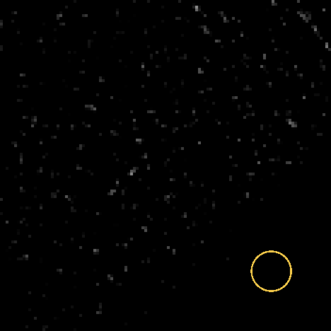
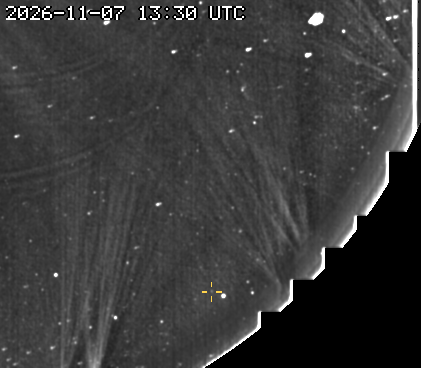
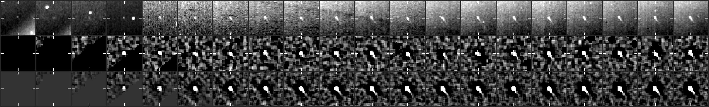
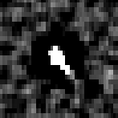

# CCOR-2 candidate 20261107T1315_1632_1770

**33 frames, 2026-11-07 13:15 to 21:15 UTC, peak 248 sigma, brightening.**

- Detected by the kreutz shift-and-stack search (8 frames stacked along the fitted motion); status candidate, alert tier since 14:00 UTC.
- Motion (-4.1, -4.1) px per 15-min frame, 5.8 px/frame.
- Last position 819 px from the Sun at position angle -53 deg, heading 8 deg off the Sun direction (the two Kreutz comets seen in CCOR-2 so far, 2026-11-02 and 11-07, arrived from the lower right, position angle -45 to -55 deg, heading within ~10 deg of the Sun).
- Matches Chuck Fields's CCOR-2 report `report_cf_20261107120006` (posted 2026-11-07T17:00+00:00; our alert came 2.6 h before it; we were following it 2.9 h before the post).

## Movie

A fixed patch of sky at 2x the camera's resolution: significance maps (stars and corona modelled out), the last 8 maps added along the fitted motion, black below 2.5 sigma. The ring rides the fitted path: green on frames with a measured hit, yellow before the first hit. A real object crosses the patch inside the ring; noise does not travel.



## Full field

The object's quadrant at half resolution, from just outside the occulter out to the field edge, the last frames up to the newest hit: each frame minus the minimum of the previous 24 hours (streamers and stars stay, the static corona and glare cancel), lightly smoothed, no stacking, on a linear scale from -2 sigma of the frame's noise (so the noise shows as grain). The crosshair follows the fitted path, yellow on a measured hit. For where the object sits in the corona and what else is moving; a faint object is easier to judge in the stacked patch above.



## Contact sheet

Top: raw frame. Middle: significance map of that frame. Bottom: the detector's view, the last 8 maps stacked along the motion. Ticks mark the predicted position; a comet is a steady dot on the ticks.





## Positions

2048x1920 full-resolution frame, origin upper left, x right, y down, 0-based (the Sungrazer 'Upper Left' convention). They are the centre of the stacked detection predicted from the fitted motion, good to about a pixel, not per-frame centroids; hunters' measurements tend to fall ~1 px right and up of these.

| date | HHMM | x | y | sigma |
|---|---|---|---|---|
| 2026-11-07 | 1315 | 1632 | 1770 | 15.9 |
| 2026-11-07 | 1330 | 1628 | 1766 | 25.0 |
| 2026-11-07 | 1345 | 1624 | 1762 | 35.6 |
| 2026-11-07 | 1400 | 1620 | 1758 | 47.2 |
| 2026-11-07 | 1415 | 1616 | 1754 | 61.6 |
| 2026-11-07 | 1430 | 1612 | 1750 | 75.1 |
| 2026-11-07 | 1445 | 1608 | 1746 | 87.5 |
| 2026-11-07 | 1500 | 1604 | 1742 | 87.9 |
| 2026-11-07 | 1515 | 1598 | 1736 | 89.4 |
| 2026-11-07 | 1530 | 1594 | 1732 | 98.0 |
| 2026-11-07 | 1545 | 1590 | 1728 | 121.4 |
| 2026-11-07 | 1600 | 1586 | 1724 | 138.1 |
| 2026-11-07 | 1615 | 1582 | 1720 | 153.3 |
| 2026-11-07 | 1630 | 1578 | 1716 | 169.2 |
| 2026-11-07 | 1645 | 1574 | 1712 | 183.0 |
| 2026-11-07 | 1700 | 1570 | 1708 | 191.6 |
| 2026-11-07 | 1715 | 1566 | 1704 | 194.6 |
| 2026-11-07 | 1730 | 1562 | 1700 | 193.2 |
| 2026-11-07 | 1745 | 1558 | 1696 | 175.9 |
| 2026-11-07 | 1800 | 1550 | 1692 | 89.9 |
| 2026-11-07 | 1815 | 1550 | 1688 | 148.0 |
| 2026-11-07 | 1830 | 1546 | 1684 | 142.6 |
| 2026-11-07 | 1845 | 1542 | 1680 | 136.7 |
| 2026-11-07 | 1900 | 1538 | 1676 | 128.7 |
| 2026-11-07 | 1915 | 1532 | 1670 | 127.8 |
| 2026-11-07 | 1930 | 1528 | 1666 | 149.8 |
| 2026-11-07 | 1945 | 1524 | 1662 | 187.6 |
| 2026-11-07 | 2000 | 1520 | 1658 | 225.4 |
| 2026-11-07 | 2015 | 1516 | 1654 | 237.3 |
| 2026-11-07 | 2030 | 1512 | 1650 | 244.0 |
| 2026-11-07 | 2045 | 1508 | 1646 | 247.6 |
| 2026-11-07 | 2100 | 1504 | 1642 | 242.9 |
| 2026-11-07 | 2115 | 1500 | 1638 | 232.4 |

Form layout (HHMM x y):

```
1315 1632 1770
1330 1628 1766
1345 1624 1762
1400 1620 1758
1415 1616 1754
1430 1612 1750
1445 1608 1746
1500 1604 1742
1515 1598 1736
1530 1594 1732
1545 1590 1728
1600 1586 1724
1615 1582 1720
1630 1578 1716
1645 1574 1712
1700 1570 1708
1715 1566 1704
1730 1562 1700
1745 1558 1696
1800 1550 1692
1815 1550 1688
1830 1546 1684
1845 1542 1680
1900 1538 1676
1915 1532 1670
1930 1528 1666
1945 1524 1662
2000 1520 1658
2015 1516 1654
2030 1512 1650
2045 1508 1646
2100 1504 1642
2115 1500 1638
```

## Movie frames

Sigma inside the ring on the fitted position vs the brightest 0.1% of the whole patch. A real object sits clearly above the tail.

| frame | ring | tail | |
|---|---|---|---|
| 20261107T121514 | 0.0 | 5.1 |  |
| 20261107T123014 | 0.0 | 5.0 |  |
| 20261107T124514 | 2.4 | 5.1 |  |
| 20261107T130014 | 12.5 | 5.5 |  |
| 20261107T131514 | 26.0 | 5.7 | hit |
| 20261107T133014 | 36.9 | 6.4 | hit |
| 20261107T134514 | 36.4 | 6.7 | hit |
| 20261107T140014 | 39.5 | 6.8 | hit |
| 20261107T141514 | 57.9 | 6.0 | hit |
| 20261107T143014 | 76.0 | 6.5 | hit |
| 20261107T144514 | 94.0 | 6.5 | hit |
| 20261107T150014 | 104.1 | 6.6 | hit |
| 20261107T151514 | 117.2 | 6.2 | hit |
| 20261107T153014 | 130.1 | 5.8 | hit |
| 20261107T154514 | 139.0 | 6.1 | hit |
| 20261107T160014 | 136.4 | 6.2 | hit |
| 20261107T161514 | 132.8 | 6.3 | hit |
| 20261107T163014 | 131.9 | 5.9 | hit |
| 20261107T164514 | 138.2 | 6.7 | hit |
| 20261107T170014 | 151.2 | 6.4 | hit |
| 20261107T171514 | 156.9 | 6.5 | hit |
| 20261107T173014 | 160.9 | 6.6 | hit |
| 20261107T174514 | 152.3 | 6.8 | hit |
| 20261107T180014 | 147.9 | 5.9 | hit |
| 20261107T181514 | 161.2 | 5.3 | hit |
| 20261107T183014 | 169.4 | 6.2 | hit |
| 20261107T184514 | 171.0 | 6.1 | hit |
| 20261107T190014 | 168.2 | 6.2 | hit |
| 20261107T191514 | 167.4 | 5.7 | hit |
| 20261107T193014 | 170.3 | 6.2 | hit |
| 20261107T194514 | 189.2 | 6.0 | hit |
| 20261107T200014 | 210.6 | 6.2 | hit |
| 20261107T201514 | 201.9 | 6.7 | hit |
| 20261107T203014 | 206.9 | 6.5 | hit |
| 20261107T204514 | 232.2 | 6.2 | hit |
| 20261107T210014 | 258.7 | 6.7 | hit |
| 20261107T211514 | 272.7 | 6.8 | hit |

*Written 2026-11-07 21:40 UTC.*
