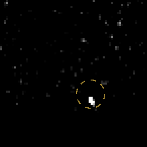
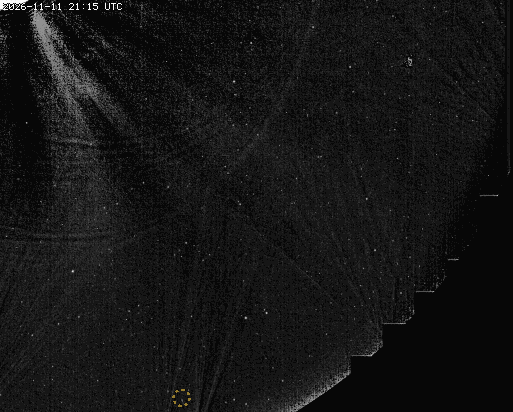
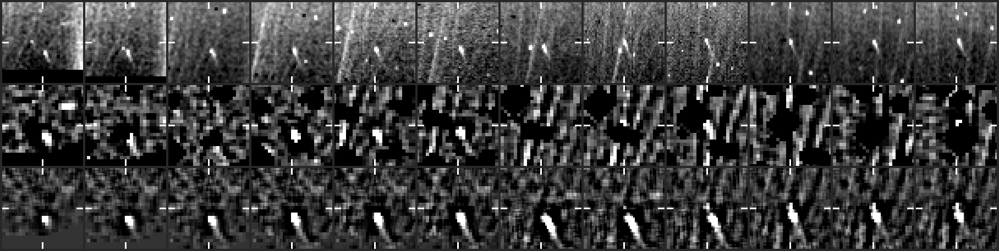
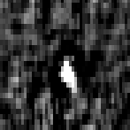

# CCOR-2 candidate 20261111T2215_1370_1874

**4 frames, 2026-11-11 22:15 to 23:45 UTC, peak 43 sigma, steady.**

- Detected by the kreutz shift-and-stack search (8 frames stacked along the fitted motion); status candidate, alert tier since 23:45 UTC.
- Motion (-3.4, -4.1) px per 15-min frame, 5.3 px/frame.
- Last position 931 px from the Sun at position angle -68 deg, heading 18 deg off the Sun direction (the two Kreutz comets seen in CCOR-2 so far, 2026-11-02 and 11-07, arrived from the lower right, position angle -45 to -55 deg, heading within ~10 deg of the Sun).
- No CCOR-1 or CCOR-2 report matches it on the Sungrazer site.

## Movie

A fixed patch of sky at 2x the camera's resolution: significance maps (stars and corona modelled out), the last 8 maps added along the fitted motion, black below 2.5 sigma. The circle sits on the object's measured positions: yellow on a frame with a measured hit, dim and dashed where it is only carried along the path (before the first hit, across a gap, after the last). A real object crosses the patch inside the circle; noise does not travel.



## Full field

The object's quadrant from just outside the occulter out to the field edge, up to the newest hit: each frame minus the median of the previous 24 hours (the static corona and glare cancel; streamers show bright where they have moved to and dark where they were; stars stay), no stacking, no smoothing, on one linear scale with zero near black, so the noise shows as grain that thickens toward the Sun. The circle is the same marker as above (yellow on a frame with a measured hit, dim and dashed otherwise), and the movie runs two hours past the last one. This GIF is every frame at half resolution; the dashboard plays them at the camera's resolution. A faint object is easier to judge in the stacked patch above.



## Contact sheet

Top: raw frame. Middle: significance map of that frame. Bottom: the detector's view, the last 8 maps stacked along the motion. Ticks mark the predicted position; a comet is a steady dot on the ticks.





## Positions

2048x1920 full-resolution frame, origin upper left, x right, y down, 0-based (the Sungrazer 'Upper Left' convention). They are the centre of the stacked detection predicted from the fitted motion, good to about a pixel, not per-frame centroids; hunters' measurements tend to fall ~1 px right and up of these.

The last column is what the track became here on that frame: spark (two bright hits, before it is a track), following (third hit), then each of the dashboard's tiers the first time it stood higher than before (steady, watch, ALERT). The owner's tags carry their clock time and sit on the newest frame that had reached us when they were given; the rest are frame times, and a frame reaches us 15 to 25 minutes after it is taken.

| date | HHMM | x | y | sigma | our status |
|---|---|---|---|---|---|
| 2026-11-11 | 2215 | 1370 | 1874 | 35.6 |  |
| 2026-11-11 | 2230 | 1368 | 1872 | 43.2 | spark |
| 2026-11-11 | 2300 | 1362 | 1864 | 30.3 | following |
| 2026-11-11 | 2345 | 1350 | 1850 | 34.0 | ALERT |

Form layout (HHMM x y):

```
2215 1370 1874
2230 1368 1872
2300 1362 1864
2345 1350 1850
```

## Movie frames

Sigma inside the ring on the fitted position vs the brightest 0.1% of the whole patch. A real object sits clearly above the tail.

| frame | ring | tail | |
|---|---|---|---|
| 20261111T211514 | 29.9 | 11.9 |  |
| 20261111T213014 | 37.2 | 10.5 |  |
| 20261111T214514 | 49.6 | 12.4 |  |
| 20261111T221514 | 54.2 | 11.2 | hit |
| 20261111T223014 | 47.5 | 12.3 | hit |
| 20261111T230014 | 40.0 | 14.8 | hit |
| 20261111T231514 | 37.9 | 14.2 |  |
| 20261111T233014 | 38.3 | 14.1 |  |
| 20261111T234514 | 28.8 | 9.8 | hit |

*Written 2026-11-12 00:06 UTC.*
